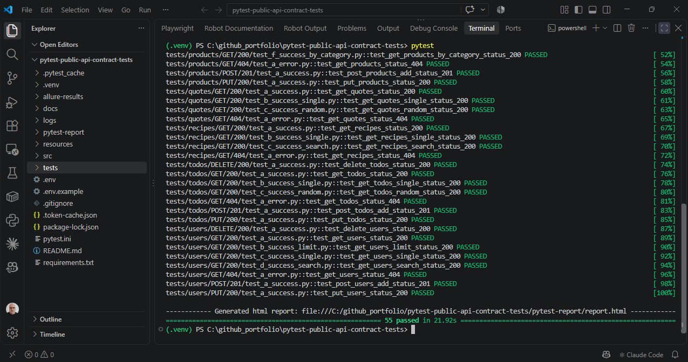
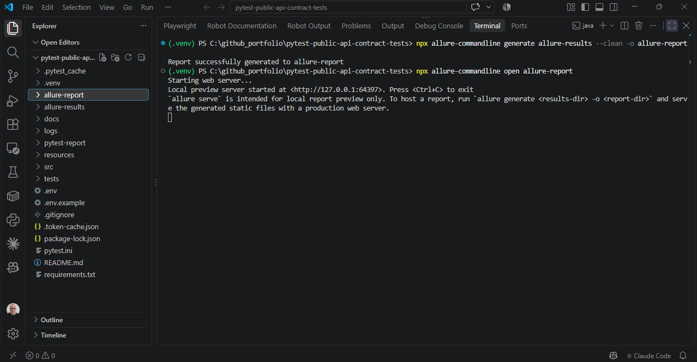
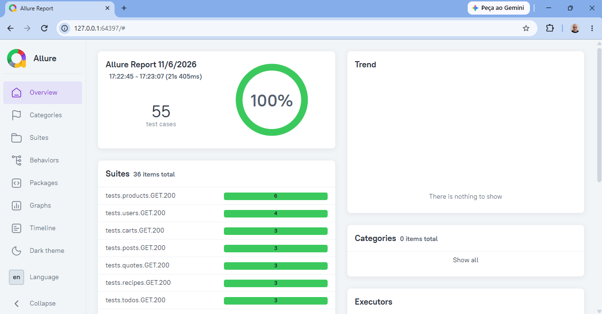
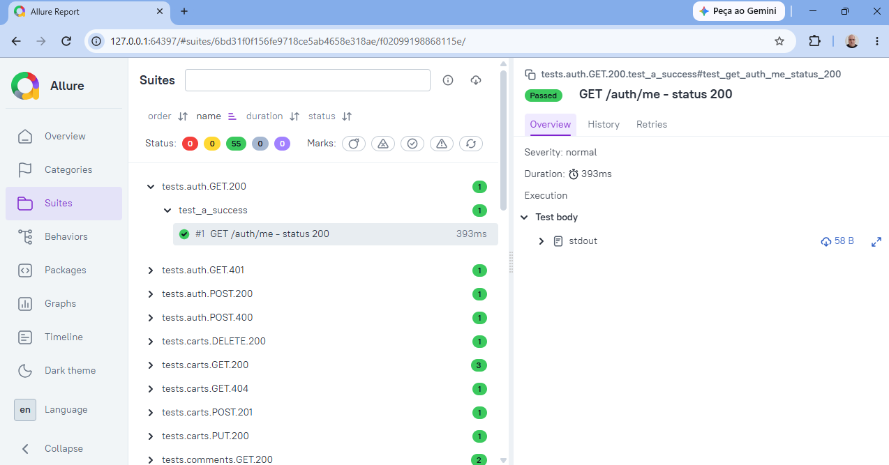
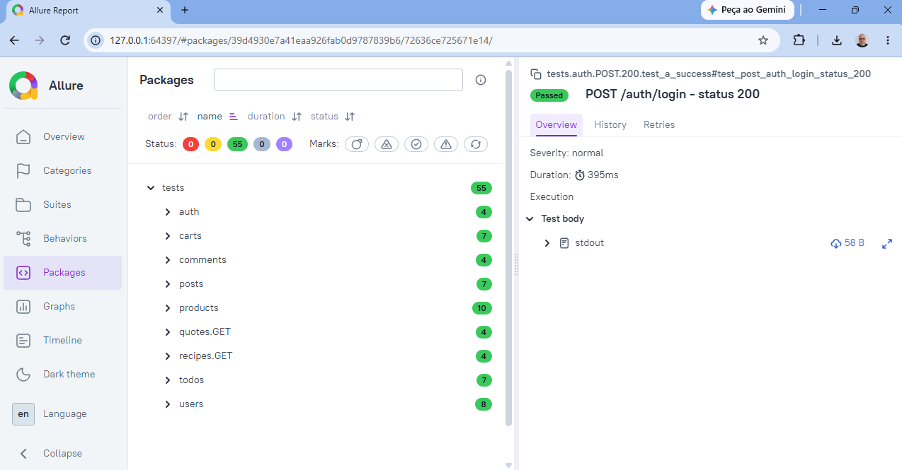
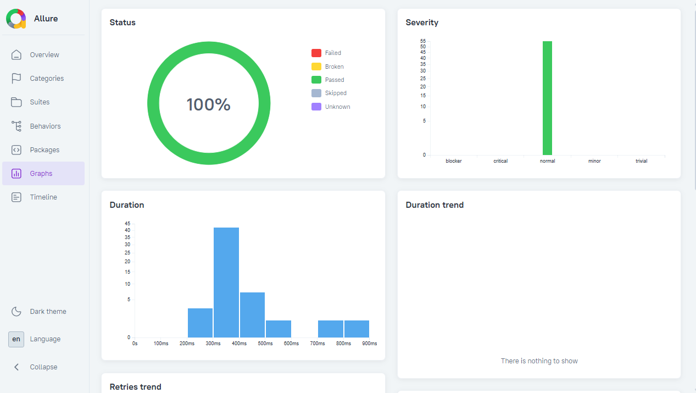

# Testes de API - Contratos com API Pública (DummyJSON)

Testes de integração e contrato de API pública (https://dummyjson.com/docs), com Python e Pytest.


## 🚀 Como Começar

```bash
# 1. Clone o repositório
git clone https://github.com/moiseschiaretto/pytest-public-api-contract-tests.git
cd pytest-public-api-contract-tests

# 2. Crie e ative o ambiente virtual
python -m venv .venv
.venv\Scripts\activate        # Windows
source .venv/bin/activate     # Linux e macOS

# 3. Instale as dependências
pip install -r requirements.txt

# 4. Configure o ambiente
cp .env.example .env

# 5. Atualize o token e execute os testes (recomendado)
python -m src.utils.auth_token
pytest

# Ou execute separadamente:
python -m src.utils.auth_token   # Só atualiza o token
pytest                           # Só executa os testes
```

Relatório padrão (pytest-html): `pytest-report/report.html`, gerado a cada execução do `pytest`. Basta abrir o arquivo no navegador.

## Relatório Allure

```bash
pytest                                                                  # roda os testes + gera allure-results/
npx allure-commandline generate allure-results --clean -o allure-report  # gera o relatório Allure
npx allure-commandline open allure-report                                # sobe um servidor local e abre o relatório no navegador
```

(gera o relatório final via `allure-commandline`, sem precisar instalar o Allure no sistema; requer Node.js e Java)

> ⚠️ **Não abra `allure-report/index.html` direto no navegador** (duplo clique / `file://`). O Allure carrega os dados via requisições JS, que o Chrome/Firefox bloqueiam por segurança quando o arquivo é aberto localmente sem servidor. Use sempre:
> ```bash
> npx allure-commandline open allure-report
> ```
> Isso sobe um servidor local e abre o relatório completo, com todos os dados carregando corretamente.

Comando alternativo, que gera e abre o relatório em uma única etapa:

```bash
npx allure-commandline serve allure-results
```

A pasta `allure-results/` é limpa automaticamente a cada execução do `pytest` (opção `--clean-alluredir` no `pytest.ini`).

---

## 📸 Resultados de execução

**Execução via terminal (VSCode) — 55 testes passando:**



**Geração e abertura do relatório Allure via terminal (VSCode):**



**Relatório Allure — Visão geral (100% de sucesso):**



**Relatório Allure — Suítes (cenários organizados por endpoint/método/status):**



**Relatório Allure — Pacotes por recurso:**



**Relatório Allure — Gráficos (status, gravidade e duração):**



---

## Por que uma API pública?

Este projeto reproduz, com dados públicos, o mesmo padrão de arquitetura usado em projetos reais de automação: separação entre configuração, serviços por recurso, utilitários genéricos, fixtures de contrato e testes organizados por recurso/método/status.

## Stack

- **Python** e **Pytest** para execução dos testes
- **Requests** para as requisições HTTP
- **jsonschema** para geração e validação de contrato (schema dinâmico a partir de uma amostra)
- **pytest-html** para o relatório padrão e **Allure** (`allure-pytest`) para o relatório completo
- **GitHub Actions** para CI/CD (roda a cada push e diariamente, para detectar quebras de contrato na API pública)

## Estrutura

```
src/
  config/
    environment.py     # variáveis de ambiente (base URL, credenciais, token em cache)
    endpoints.py        # constantes de endpoints
  services/
    base_service.py      # métodos HTTP padrão: post, get_all, get_id, put_id, patch_id, delete_id
    auth_service.py       # um serviço por recurso (auth, product, user, cart, todo, post, quote, recipe, comment)
  utils/
    requests.py          # make_request() — função única para todos os métodos HTTP
    validators.py        # validação de contrato (schema/tipos) e validação exata
    files.py              # salva logs de response em JSON e carrega fixtures
    auth_token.py         # autentica e cacheia o accessToken localmente
tests/
  {recurso}/{METODO}/{status}/test_*.py
resources/fixtures/
  public-api/{recurso}/{METODO}/{status}/*.json        # "contratos" esperados (schema, não valor exato)
  public-api/{recurso}/{METODO}/request/valid.json     # body enviado nas requisições POST e PUT
docs/
  screenshots/          # capturas de tela da execução e dos relatórios
logs/                    # responses reais salvas a cada execução (não versionado)
pytest.ini               # configuração do Pytest (caminho de importação, relatórios e nova tentativa)
requirements.txt         # dependências do projeto
```

## Page Object Model (POM) de API

Cada recurso da API tem um serviço em `src/services`. O teste cria o serviço e chama o método pelo verbo HTTP, sem montar URL, token ou cabeçalhos:

```python
import allure
from src.services.product_service import ProductService
from src.utils.validators import validate_response_with_json_schema
from src.utils.files import load_expected_data, load_json_fixture


# POST /products/add - simula criação de produto
@allure.title('POST /products/add - status 201')
def test_post_products_add_status_201():
    folder_path = 'public-api/products/POST/201'
    body = load_json_fixture('resources/fixtures/public-api/products/POST/request/valid.json')
    product_service = ProductService()

    response, response_data = product_service.post(
        body=body,
        expected_status=201,
        save_response_log=folder_path
    )

    expected_shape = load_expected_data(folder_path, 'a.success.json')
    validate_response_with_json_schema(response_data, expected_shape, validation_mode='allow-extra')

    assert response_data['title'] == body['title']
```

Caminho da chamada: teste → serviço do recurso (`ProductService`) → `BaseService.send` → `make_request`.

**Importações a partir da raiz:** o `pytest.ini` define `pythonpath = .`, então todos os imports partem da raiz do projeto (`from src.utils.files import ...`), sem caminhos relativos. No VS Code, o **Ctrl + clique** no nome da classe ou do método abre o arquivo correspondente.

## Por que validação de contrato por SCHEMA (e não por valor exato)?

Como a API é pública e os dados mudam (preços, quantidades, IDs), validar valor por valor quebraria os testes sem motivo real. Por isso a validação (`validate_response_with_json_schema`) verifica **estrutura e tipos** — o "contrato" — permitindo que os valores variem livremente. Isso é o padrão usado em testes de contrato no mercado (o objetivo é garantir que a API não mudou o formato da resposta, não que os dados sejam idênticos a ontem).

## Cobertura de cenários

**55 cenários** cobrindo 9 recursos (`auth`, `products`, `users`, `carts`, `todos`, `posts`, `quotes`, `recipes`, `comments`), com múltiplos métodos (GET, POST, PUT, DELETE) e múltiplos status por método (200, 201, 400, 401, 404).

## Credenciais

As credenciais em `.env.example` são o **usuário de demonstração publicado oficialmente pela própria DummyJSON** na documentação (https://dummyjson.com/docs/auth) — não são segredo de ninguém, servem só para gerar um token de teste válido.
